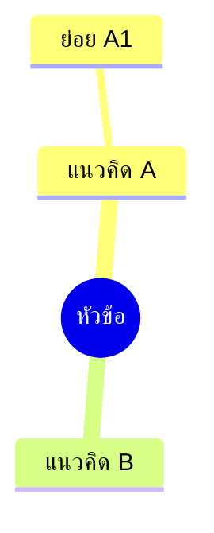

# โครงไฟล์ knowledge.md

ใช้โครงนี้เป็นค่าเริ่มต้น ตัดหัวข้อที่ไม่เกี่ยวกับเนื้อหาออกได้ (เช่น เรื่องที่ไม่มีสูตร ก็ไม่ต้องมีหัวข้อสูตร) แต่ห้ามตัดส่วน 1, 3, 5, 6, 10 เพราะ lesson-builder และ audio-teacher พึ่งส่วนเหล่านี้

```markdown
# <ชื่อหัวข้อ>

> ผู้เรียนเป้าหมาย: ... | เป้าหมายการเรียน: ... | อัปเดตล่าสุด: YYYY-MM-DD
> วัตถุดิบ: <รายชื่อไฟล์ที่อ่าน> + <คีย์เวิร์ดที่ค้น>

## 1. แก่นของเรื่อง (Big Idea)
3–5 ประโยค อธิบายแบบที่คนทั่วไปเข้าใจ + ทำไมเรื่องนี้สำคัญ

## 2. แผนผังความคิด


## 3. ลำดับการเรียนรู้ (Prerequisite map)
1. แนวคิดพื้นฐาน X — ต้องรู้ก่อนเพราะ...
2. แนวคิด Y (ต่อยอดจาก X)
...
(ใช้เป็นลำดับบทเรียน)

## 4. อภิธานศัพท์
| คำ | ความหมายแบบเข้าใจง่าย | ภาษาอังกฤษ |

## 5. แนวคิด/หลักการหลัก
### 5.1 <ชื่อแนวคิด>
- **คืออะไร (จำ):** นิยามสั้น
- **อธิบายด้วยภาษาตัวเอง (เข้าใจ):** ...
- **กลไก/ทำไมจึงเป็นเช่นนั้น:** ...
- **เงื่อนไข/ข้อจำกัด:** ใช้ไม่ได้เมื่อ...
- **ตัวอย่างจากเอกสาร:** ... (ที่มา: หน้า ...)
- **ตัวอย่างใหม่:** ...
- **ไม่ใช่ตัวอย่าง (non-example):** ... เพราะ...
- **เปรียบเทียบ/อุปมา:** "เหมือนกับ..."
- **ที่มา:** ...

## 6. แยกแยะสิ่งที่สับสนง่าย (วิเคราะห์)
| ประเด็น | แนวคิด A | แนวคิด B |
และคำถามชี้ขาด: "ถ้าเจอสถานการณ์ ... ให้ถามตัวเองว่า ..."

## 7. ความเข้าใจผิดที่พบบ่อย
- ❌ เข้าใจผิด: ... → ✅ ที่ถูก: ... (ทำไมคนถึงเข้าใจผิด)

## 8. การประยุกต์ใช้
ขั้นตอนนำไปใช้ + สถานการณ์จริง 2–3 แบบ (ระบุบริบท ปัญหา วิธีใช้หลักการ ผลลัพธ์)

## 9. การประเมินเชิงวิพากษ์
จุดแข็ง / ข้อจำกัด / คำวิจารณ์ / ประเด็นถกเถียงระหว่างแหล่ง

## 10. การสร้างสรรค์ต่อยอด
ไอเดียเป็นรูปธรรม 2–3 ข้อ ที่รวมแนวคิดนี้กับเรื่องอื่น หรือใช้ในบริบทใหม่

## 11. สรุปสำหรับทบทวน
- bullet 5–10 ข้อที่ต้องจำได้

## 12. คำถามทดสอบตัวเอง (ครอบคลุม Bloom)
- จำ: ...  - เข้าใจ: ...  - ประยุกต์: ...  - วิเคราะห์: ...  - ประเมิน: ...  - สร้างสรรค์: ...
(ใส่แนวคำตอบสั้น ๆ ไว้ใต้แต่ละข้อ)

## 13. แหล่งอ้างอิง
- [เอกสารผู้ใช้] ชื่อไฟล์ — ส่วนที่ใช้
- [ค้นเพิ่ม] ชื่อแหล่ง — URL

## 14. สิ่งที่ยังไม่แน่ใจ / ช่องว่างความรู้
## ประวัติการปรับปรุง
```
